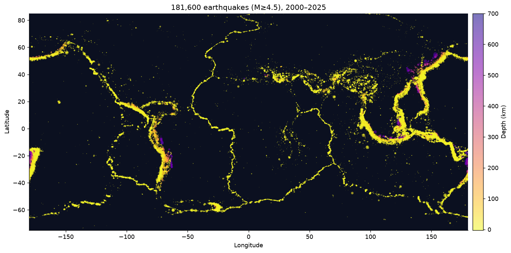
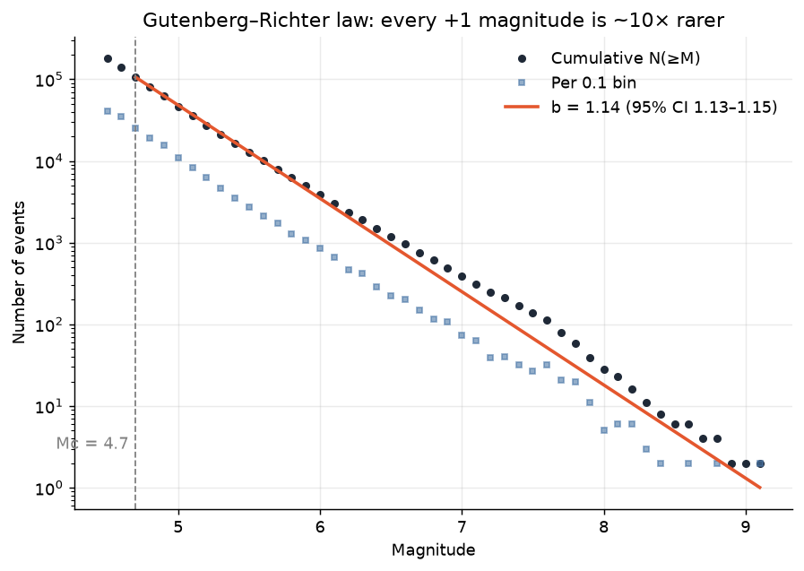
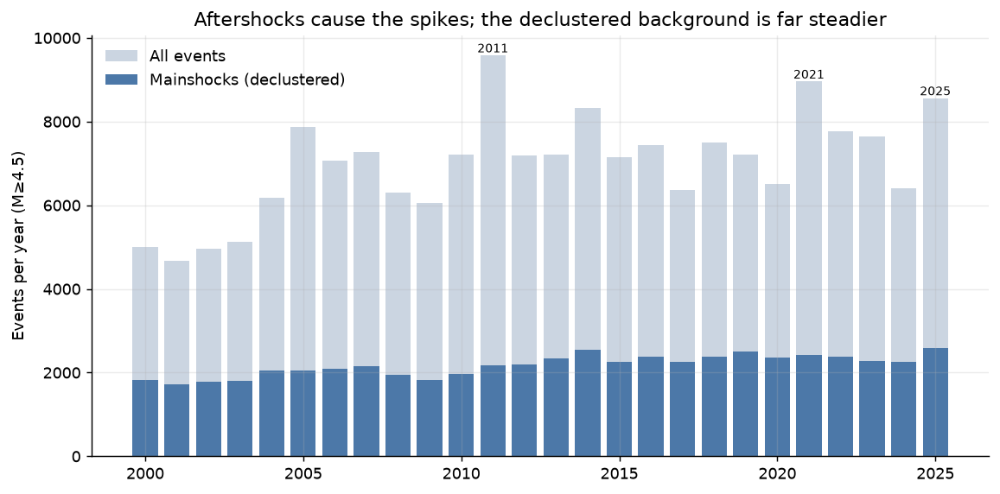
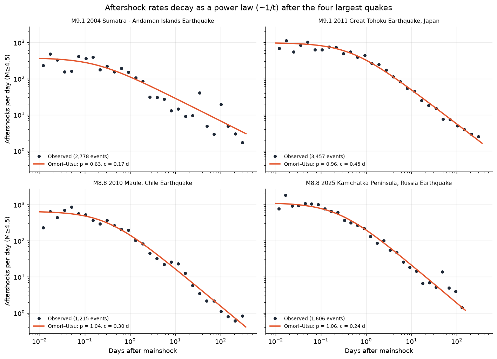
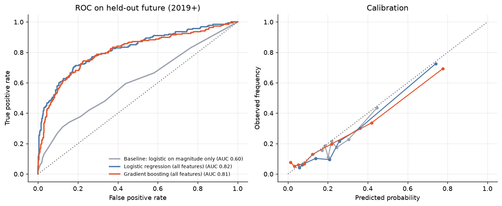
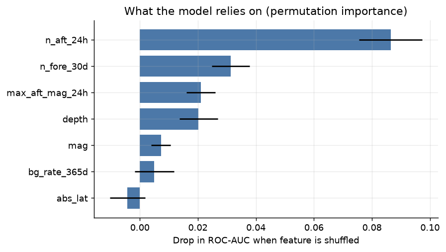

# 🌋 Quakescope

**26 years of global earthquakes, 181,600 events: classic seismology laws checked against real data, plus a model that predicts large aftershocks better than magnitude alone.**



*Every M≥4.5 earthquake from 2000 to 2025, coloured by depth. No coastlines are drawn: the tectonic plate boundaries appear from the data alone. Deep (purple) events trace subducting slabs beneath Japan, Tonga, and South America.*

---

## What this project shows

| | Question | Method | Result |
|---|---|---|---|
| 1 | How much rarer is a big quake than a small one? | Gutenberg–Richter, Aki MLE + bootstrap | **b = 1.14** (95% CI 1.13–1.15), about 14× fewer events per +1 magnitude |
| 2 | How much of the catalog is aftershocks? | Gardner–Knopoff space-time declustering | **69%** of events belong to clusters |
| 3 | How fast do aftershocks die off? | Omori–Utsu point-process MLE | **p ≈ 0.96–1.06** for 3 of the 4 great quakes (rate ∝ 1/t) |
| 4 | Can we predict a strong aftershock 24 h after a big quake? | Leakage-free features, temporal split, logistic vs. gradient boosting | **ROC-AUC 0.82** vs 0.61 for magnitude alone |

All numbers come from [`reports/metrics.json`](reports/metrics.json), which the pipeline regenerates.

---

## 1. Gutenberg–Richter law



The magnitude–frequency distribution is a straight line on a log scale above the completeness magnitude **Mc = 4.7** (maximum curvature + 0.2). The b-value is estimated by maximum likelihood (Aki 1965, with Utsu's binning correction) and has a bootstrap confidence interval.

After declustering, b drops to **0.92** (CI 0.91–0.93). Aftershock sequences add many small events, so removing them flattens the slope, which is the effect reported in the literature.

## 2. Declustering: separating aftershocks from background



Gardner–Knopoff windows grow with magnitude, from about 40 km and 144 days for M5 to about 125 km and 2.9 years for M9. The spikes in raw counts (2011 Tōhoku, 2021, 2025) come from aftershocks. The mainshock series is much smoother. The slow upward drift in background counts is most likely due to better seismic networks over time, not more earthquakes.

## 3. Omori's law on the four largest quakes



The aftershock rate follows **n(t) = K / (c + t)^p**. It is fit by maximum likelihood on the event times (Ogata 1983), not by regression on binned counts.

- Tōhoku, Maule and Kamchatka give **p = 0.96, 1.04, 1.06**, close to the textbook p ≈ 1.
- Sumatra 2004 is the outlier with **p = 0.63**. The reason is in the data: the **M8.6 Nias earthquake** struck 184 km away, 92 days later, and started its own aftershock sequence. Omori's law assumes a single sequence, so a sequence nested inside another flattens the fitted decay.
- Gardner–Knopoff windows stop growing at about 125 km, but a great quake ruptures 500–1,300 km. So these sequences use one Wells–Coppersmith rupture length as the radius. With the GK window, Sumatra kept only 233 aftershocks instead of 2,778.

## 4. Predicting strong aftershocks

**Task:** It is 24 hours after an M≥6 earthquake. Will an **M≥5.5** event occur within the mainshock's GK radius between **day 1 and day 30**?

**Features**, all known at the 24-hour mark:

| Feature | Meaning |
|---|---|
| `mag`, `depth`, `abs_lat` | Mainshock properties |
| `n_aft_24h`, `max_aft_mag_24h` | How productive the first day was |
| `n_fore_30d` | Foreshocks in the 30 days before |
| `bg_rate_365d` | Background regional activity (300 km, the prior year) |

**Validation:** temporal split. Train on 2000–2018 (2,933 mainshocks) and test on 2019–2025 (931 mainshocks, base rate 20%). A random split would leak information between overlapping sequences.

| Model | ROC-AUC | PR-AUC | Brier |
|---|---|---|---|
| Baseline: logistic on magnitude only | 0.605 | 0.326 | 0.155 |
| **Logistic regression (all features)** | **0.820** | **0.643** | **0.114** |
| Gradient boosting (all features) | 0.807 | 0.594 | 0.120 |





**Takeaways**
- **Early productivity matters most.** The number of aftershocks in the first 24 hours outweighs every other feature. Magnitude alone barely beats chance.
- **The simple model won.** Gradient boosting did not beat a well-specified logistic regression on about 3k samples. The extra complexity was not worth it.
- **Probabilities are usable.** Both models are reasonably calibrated, which matters more for hazard communication than ranking.

## Limitations

- The USGS catalog mixes magnitude types (mb, Mww, ...). This probably steepens the global b-value and bends the G–R curve at high magnitude.
- Gardner–Knopoff windows are a heuristic. ETAS-based stochastic declustering would be the next step.
- The model is a portfolio demonstration, **not** an operational forecast. Real aftershock forecasts (for example from the USGS) use ETAS models with region-specific parameters.

---

## Run it yourself

```bash
git clone https://github.com/Wannkw/quakescope.git
cd quakescope
python -m venv .venv && source .venv/bin/activate   # Windows: .venv\Scripts\activate
pip install -r requirements.txt

python scripts/run_pipeline.py      # downloads ~17 MB from USGS on first run (cached in data/)
pytest                              # unit tests on synthetic data with known answers
```

## Project structure

```
quakescope/
├── src/quakescope/
│   ├── data.py              # USGS FDSN API client + cache + cleaning
│   ├── stats.py             # haversine, G-R b-value (MLE + bootstrap), Omori-Utsu MLE
│   ├── decluster.py         # Gardner-Knopoff declustering, O(N log N)
│   ├── aftershock_model.py  # leakage-free feature builder, temporal split, models
│   └── plots.py             # all figures
├── scripts/run_pipeline.py  # end-to-end: data -> stats -> model -> figures + metrics.json
├── tests/                   # estimators checked against synthetic ground truth
└── reports/                 # figures/ and metrics.json
```

The tests check the statistics, not only the code. They generate synthetic catalogs with known b and p values and confirm that the estimators recover them.

## Data

[USGS ComCat](https://earthquake.usgs.gov/fdsnws/event/1/) via the FDSN event web service, M≥4.5, 2000-01-01 to 2025-12-31. Public domain.

## References

- Aki, K. (1965). Maximum likelihood estimate of b in the formula log N = a − bM.
- Gardner, J. K. & Knopoff, L. (1974). Is the sequence of earthquakes in Southern California, with aftershocks removed, Poissonian?
- Ogata, Y. (1983). Estimation of the parameters in the modified Omori formula for aftershock frequencies by the maximum likelihood procedure.
- Wells, D. L. & Coppersmith, K. J. (1994). New empirical relationships among magnitude, rupture length, rupture width, rupture area, and surface displacement.
